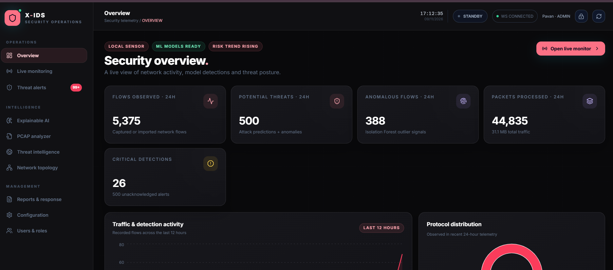
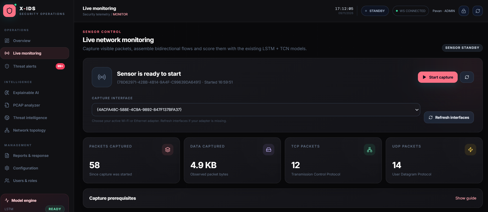
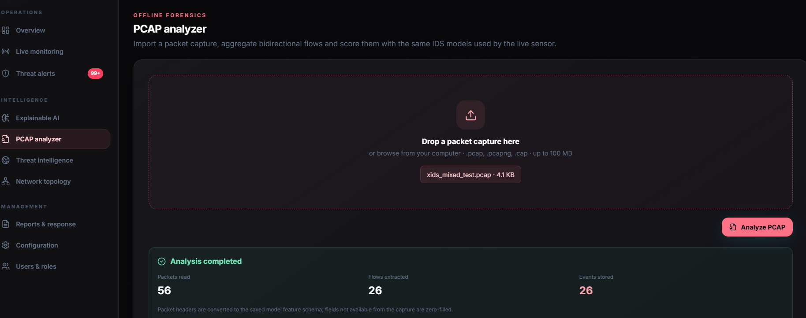

# X-IDS 2.0 | Explainable Intrusion Detection System

An AI-powered network security monitoring system that detects suspicious traffic, analyzes potential threats, and explains why an event was flagged.

X-IDS combines machine learning, real-time packet monitoring, and Explainable AI to make network threat detection easier to understand.

## What it does

- **Live Network Monitoring** – Capture and monitor incoming and outgoing network traffic.
- **AI-Based Detection** – Use LSTM and TCN models to classify network activity.
- **Explainable AI** – Understand model predictions using SHAP and LIME.
- **Threat Alerts** – View, search, investigate, and acknowledge suspicious events.
- **PCAP Analysis** – Upload network capture files for offline analysis.
- **Security Dashboard** – Monitor traffic statistics, alerts, protocols, and network activity.
- **IP Intelligence** – Check IP reputation and approximate geolocation through optional integrations.
- **Network Topology** – Visualize observed network endpoints and connections.
- **PDF Reports** – Generate security reports.
- **Firewall Response** – Manually block or unblock eligible public IP addresses.

## Tech Stack

| Area | Technologies |
|---|---|
| Frontend | React, Vite, Tailwind CSS |
| Backend | Python, Django, Django REST Framework |
| Machine Learning | TensorFlow, LSTM, TCN, Scikit-learn |
| Explainable AI | SHAP, LIME |
| Network Monitoring | Scapy, WebSockets |
| Database | SQLite / PostgreSQL |
| Visualization | Recharts, React Flow |

## How it works

1. Network packets are captured and grouped into flows.
2. Extracted flow features are passed to the trained ML models.
3. The system analyzes network activity and generates predictions.
4. Suspicious events appear on the security dashboard.
5. SHAP and LIME help explain model predictions.
   
## Screenshots

### Security Dashboard


### Live Network Monitoring


### PCAP Analyzer


## Getting Started

### Requirements

- Python 3.11
- Node.js 20 or later
- Npcap (required for live packet capture on Windows)
- Windows 10/11

### Installation

Clone the repository:

```bash
git clone https://github.com/asivasaipavan/X-IDS-2.0.git
cd X-IDS-2.0
```

Create and activate a virtual environment:

```bash
py -3.11 -m venv venv
venv\Scripts\activate
```

Install dependencies:

```bash
pip install -r requirements.txt
python manage.py migrate
```

Set up the frontend:

```bash
cd frontend
npm install
cd ..
```

Create an administrator account:

```bash
python manage.py createsuperuser
```

### Run the application

Start both services using:

```bash
start_xids.bat
```

Or start the backend and frontend separately:

**Backend**
```bash
venv\Scripts\activate
python manage.py runserver 127.0.0.1:8000
```

**Frontend**
```bash
cd frontend
npm run dev
```

Open: `http://127.0.0.1:5173/`

Backend health check: `http://127.0.0.1:8000/api/health/`

## Important Notes

- The included models use binary labels: `Attack` and `Normal`.
- Live predictions are experimental because packet-derived features may not perfectly match the original CIC-IDS2017 training features.
- AbuseIPDB, GeoIP, and email notifications require optional configuration.
- Live monitoring and firewall actions require appropriate permissions.
- This is a local-first research and demonstration project, not a production-ready security appliance.

## Dataset

This project uses the **CIC-IDS2017** dataset for model training and evaluation.

## Future Improvements

- Improve live feature extraction accuracy.
- Expand attack classification.
- Improve detection performance and validation.
- Add more advanced threat intelligence integrations.

## Author

**Siva Sai Pavan**

GitHub: [@asivasaipavan](https://github.com/asivasaipavan)

Project: [X-IDS 2.0](https://github.com/asivasaipavan/X-IDS-2.0)
